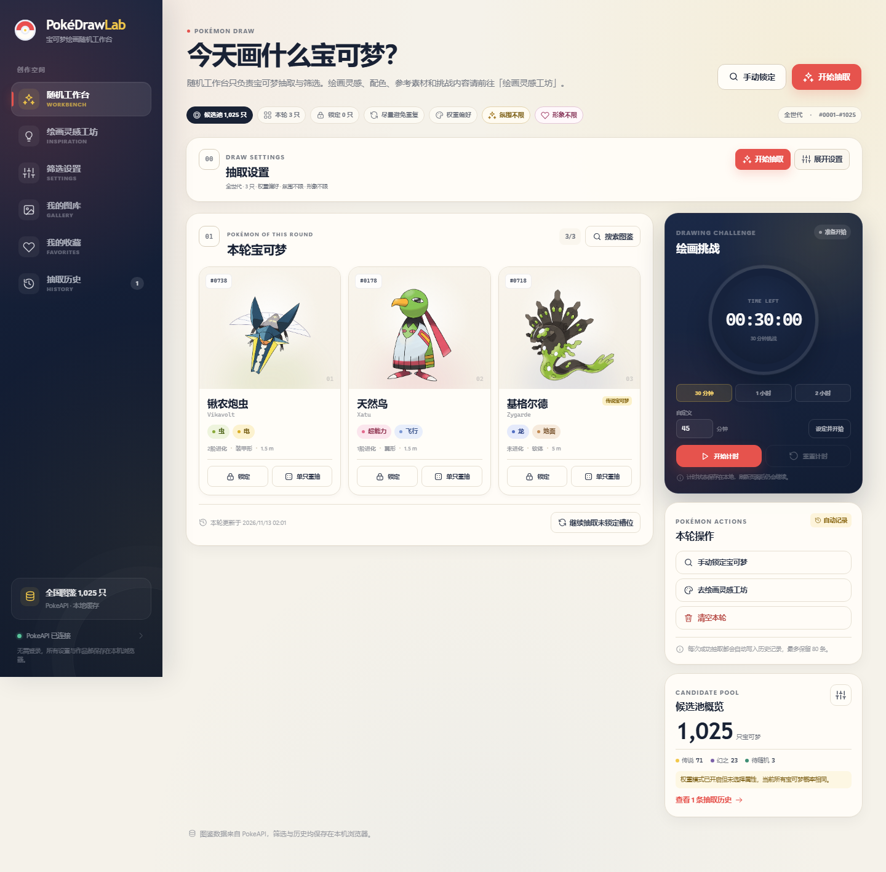
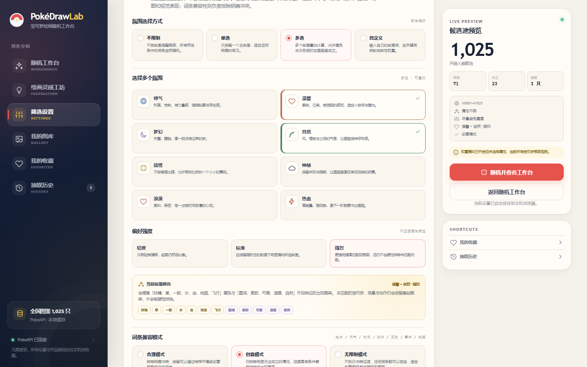
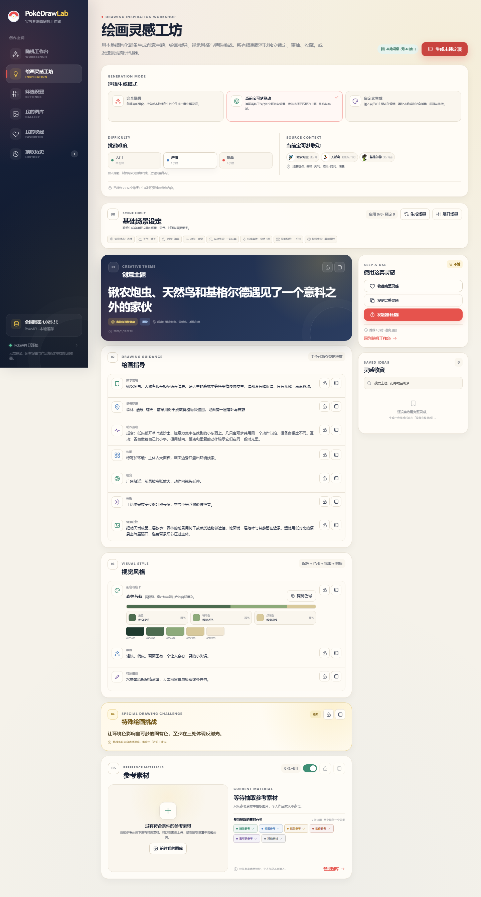
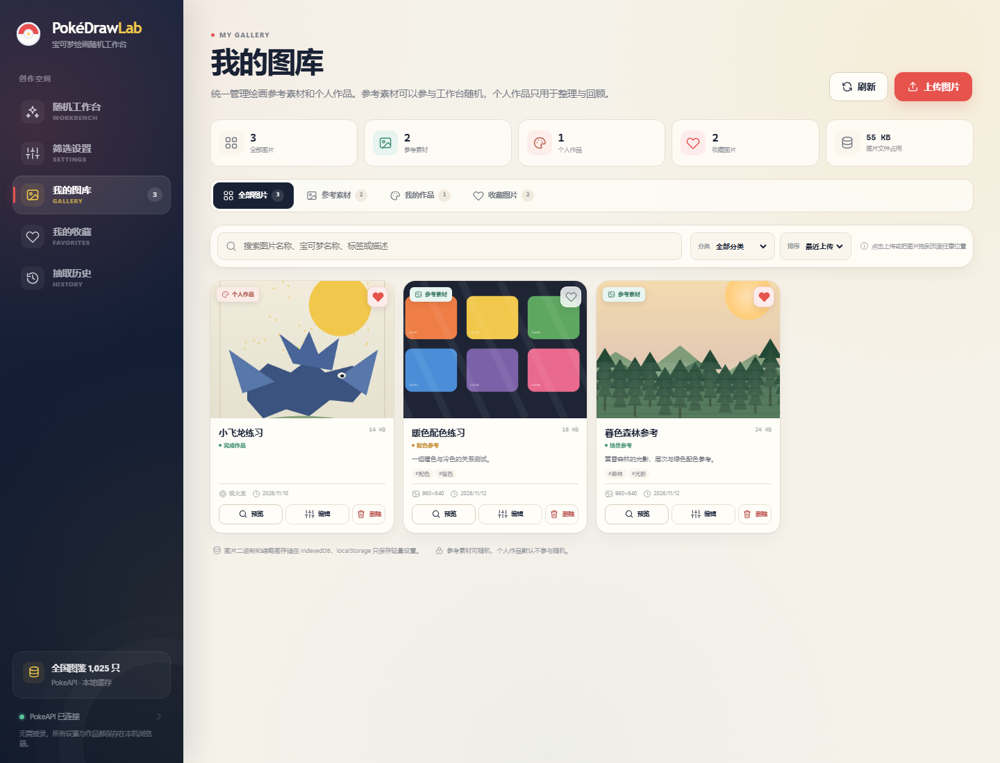
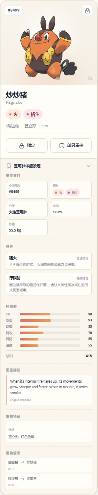
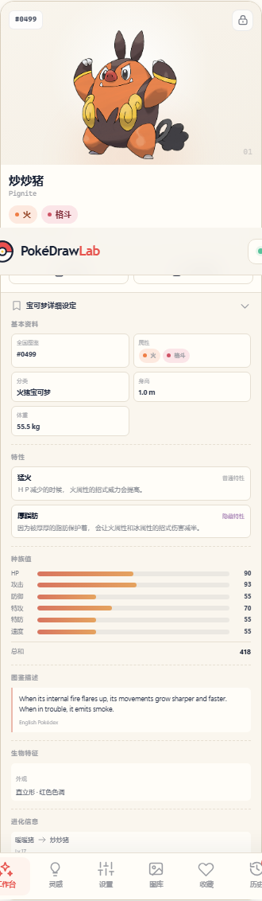
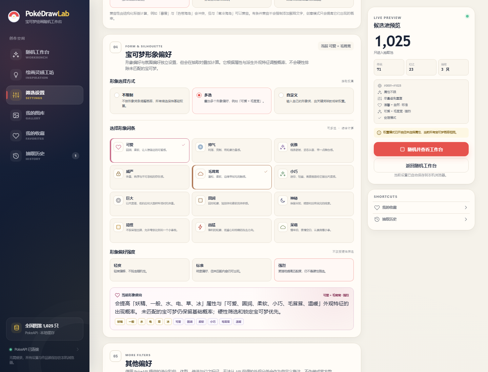

# Pokémon Drawing Lab · 宝可梦绘画随机工作台

一个面向宝可梦爱好者的绘画灵感生成工具。它从全国图鉴中抽取宝可梦，随机组合场景、天气、时间、动作和互动，也可以在「绘画灵感工坊」里生成创意主题、绘画指导、视觉风格与特殊绘画挑战。

项目为纯前端 React + Vite 应用，无需注册、无需后端、无需 API Key。设置、收藏、历史、灵感和计时状态保存在浏览器 localStorage 中；「我的图库」的图片二进制、缩略图和元数据保存在 IndexedDB 中。









> [!IMPORTANT]
> **不要直接双击 `index.html`。** 这是 React + Vite 项目，直接以文件方式打开会因浏览器安全限制而无法加载界面。
>
> Windows 用户请双击项目根目录中的 **[启动.bat](启动.bat)**。它会自动安装依赖、启动本地服务器并打开浏览器。

## 快速开始

环境要求：

- Node.js **20.19+ 或 22.12+**（推荐 22 LTS）
- npm 10+
- Chrome、Edge、Safari 或现代手机浏览器

### 方式一：Windows 一键启动（推荐）

双击项目根目录中的 **`启动.bat`**。

首次运行会自动执行 `npm install`，随后启动服务器并打开浏览器。使用期间保持黑色命令行窗口开启；关闭窗口会停止服务器。

### 方式二：手动启动

在项目根目录打开终端：

```bash
npm install
npm run dev
```

浏览器打开终端显示的本地地址，通常是：

```text
http://localhost:5173/
```

如果双击 `index.html`，页面会显示一份启动说明，而不是白屏。

生产构建：

```bash
npm run build
npm run preview
```

> Windows PowerShell 如果提示“禁止运行脚本”，可以使用 `npm.cmd install` 和 `npm.cmd run dev`。这是 PowerShell 执行策略问题，不是项目问题。

### 手机访问

Vite 已配置 `host: true`。电脑和手机连接同一 Wi-Fi 后，在手机浏览器访问：

```text
http://电脑的局域网IP:5173/
```

例如 `http://192.168.1.20:5173/`。如无法访问，请允许 Windows 防火墙对 Node.js 的局域网访问。

## 功能总览

### 随机工作台（只负责宝可梦）

- 保留：宝可梦随机抽取与数量、世代 / 编号范围 / 属性 / 进化 / 体型 / 传说幻之筛选、形象偏好、氛围偏好、重复规则、搜索、手动锁定、单只重抽、结果详情、候选池、计时器和抽取历史。
- 开始抽取只更新宝可梦。工作台不再生成绘画灵感、配色、参考素材、场景画面或绘画提示。
- 工作台不再显示场景设定、参考素材、灵感卡片、配色卡片和完整提示条。
- 候选池、锁定冲突、批量锁定、清空本轮、历史入口和绘画挑战计时器继续保留。
- 绘画创作统一从工作台的「去绘画灵感工坊」进入。

### 宝可梦详细设定

- 每只宝可梦结果卡片下方都有独立的「宝可梦详细设定」区域，默认展开，单卡可独立收起。
- 基本资料：全国图鉴编号、属性、分类、身高、体重。
- 特性：普通特性、隐藏特性及说明；按 PokeAPI 返回的数据展示。
- 种族值：HP / 攻击 / 防御 / 特攻 / 特防 / 速度 / 总和，使用条形图展示。
- 图鉴描述：优先中文，缺少中文时使用英文，并标注来源语言。
- 生物特征：外观（体型 / 颜色）与栖息环境；没有结构化数据的习性不编造。
- 进化信息：进化链和触发条件，包括等级、道具、时间、亲密度等。
- 特殊形态：存在地区形态、超级进化或其他 variety 时以标签展示。
- 首次展开时读取 PokeAPI 并写入本地缓存；同一只宝可梦再次展开不会重复请求。多张卡片各自独立加载。
- 详细资料加载失败时保留基本卡片信息并显示重试，不阻塞抽取和页面操作。





### 页面分工与数据共享

- 侧边栏保留「随机工作台」与「绘画灵感工坊」两个核心入口；筛选设置、图库、收藏、历史仍作为独立工具入口。
- 每轮只维护一份 `pdl.inspiration.v1`；工坊读取工作台当前宝可梦与场景，生成后写回同一对象。
- 工作台重新抽取后，工坊不会自动覆盖；会显示“来源不同”的主动同步提示。用户点击同步后才更新未锁定内容，锁定内容始终保留。
- 工坊的场景设定、参考素材、配色与灵感收藏都在同一页面完成，不重复存储第二套灵感或配色。
- 工坊生成结果可发送到工作台计时器；工作台历史 / 收藏仍保留原有记录。
### 氛围与词条兼容

- 保留八种氛围：帅气、温馨、梦幻、自然、搞怪、神秘、浪漫、热血。
- 支持不限制、单选、多选、自定义四种方式，以及轻度、标准、强烈三档偏好强度。
- 氛围是软性概率偏好：未匹配属性或外观的宝可梦仍然可以出现，不会被氛围硬性排除。
- 同时影响：
  - 宝可梦属性权重（双属性分别累加）；
  - 由体型、颜色、尺寸、传说 / 幻之 / 幼年标记与属性派生的外观特征；
  - 地点、天气、时间；
  - 动作、互动关系；
  - 绘画构图与视觉表现。
- 用户设置的硬性属性筛选在氛围权重之前执行；锁定宝可梦不参与氛围权重抽取。
- 自定义氛围按关键词映射到已有氛围倾向；无法识别的自定义词只作为文字记录，不会乱加属性权重。
- 统一的标签兼容性引擎覆盖地点 / 天气、地点 / 时间、天气 / 宝可梦、宝可梦 / 动作、宝可梦互动、事件 / 环境、氛围 / 场景与氛围 / 宝可梦。
- 三种兼容模式：
  - **合理模式**：排除明确冲突，保留有条件兼容；
  - **创意模式**：仍排除明确冲突，但提高有条件兼容组合的出现概率；
  - **无限制模式**：不执行冲突过滤，允许任意组合。
- 场景词条拥有环境、温度、气候、生态、地形、时间、情绪、视觉风格、动作要求等结构化标签，不靠词条名称判断冲突。
- 区分普通小岛、热带海岛与寒冷海岛：暴雪与热带海岛冲突，与寒冷海岛可兼容。
- 锁定内容互相冲突时只提示，不自动修改；单独重抽天气等模块不会影响其他模块。
- 所有氛围映射、词条标签与兼容规则均在独立配置数据中，新增词条不需要重写随机核心。

### 宝可梦形象偏好

- 保留 12 个形象词条：可爱、帅气、优雅、威严、毛茸茸、小巧、巨大、圆润、神秘、搞怪、凶猛、呆萌。
- 支持多选、自定义和不限制；三级偏好强度：轻度、标准、强烈。
- 作为抽取权重，不是硬性筛选：未匹配宝可梦仍保留基础概率。
- 根据属性、由体型 / 颜色 / 尺寸 / 进化或传说标记派生的外观特征综合计算。
- 多个形象词条叠加；双属性分别贡献。
- 与氛围偏好独立设置，但在抽取时叠加计算：`属性基础权重 × 氛围权重 × 形象权重`。
- 用户硬性属性筛选和锁定宝可梦优先级最高。
- 自定义形象词按关键词映射到已有倾向；未识别词不会凭空增加属性权重。
- 形象偏好同时影响绘画灵感工坊的主题、动作、环境、互动、构图和色彩。



### 绘画灵感工坊

- 三种生成模式：
  - **完全随机**：不读取当前组合，从本地词库重新组合一套灵感；
  - **当前宝可梦联动**：读取当前工作台的宝可梦类型与场景，优先选择匹配的主题、动作、背景和光影；
  - **自定义生成**：输入自己的主题 / 关键词，再用本地规则补全其余维度。
- 内容：创意主题、故事情境、绘画指导、视觉风格、特殊绘画挑战、基础场景设定与参考素材。
- 绘画指导包含：故事情境、场景环境、动作互动、构图、视角、光影、背景建议，共 7 个可独立锁定 / 重抽的维度。
- 基础场景设定包含地点、天气、时间、动作、互动、特殊事件、绘画构图、视觉表现 8 个模块；联动生成会读取当前场景。
- 参考素材面板提供分类筛选、自动参考开关、重抽、锁定、空状态和素材库跳转。
- 视觉风格展示主色 / 辅助色 / 点缀色、比例、五色色卡、氛围与材质，并支持复制色号。
- 视觉风格包含配色方案、五色色卡、氛围和材质建议。
- 工坊读取随机工作台当前宝可梦、数量、属性和场景；首次生成或主动同步时写入同一份 `inspiration` 对象。
- 打开工坊不自动生成，不覆盖旧数据；工作台重新抽取后只显示同步提示。
- 用户在工坊修改后写回同一对象，返回工作台仍保留；除非用户主动点击生成，否则不会被工作台旧数据覆盖。
- 支持入门 / 进阶 / 挑战三个难度，影响可选主题复杂度、挑战条目和推荐计时时长。
- 12 个维度均可独立锁定 / 解锁 / 重抽；整体重新生成只替换未锁定维度，并校正冲突项。
- 内置主题与场景、动作与场景 / 体型、光影与天气 / 时间、配色与场景 / 天气的语义兼容规则，避免明显矛盾。
- 完整灵感可收藏、搜索、删除、重新载入；收藏包含全部维度、锁定状态、模式与难度。
- 可将灵感发送到现有绘画挑战计时器，自动设置入门 30 分钟 / 进阶 1 小时 / 挑战 2 小时。
- 支持复制完整文字灵感。
- 所有内容来自本地结构化词条与随机规则，不调用 AI 文本或图像 API，不生成伪造的 AI 图片。

### 我的图库

- 统一管理两类图片：
  - **参考素材**：场景、构图、配色、动作、宝可梦、其他素材；
  - **个人作品**：可填写作品名称、对应宝可梦、绘画日期、绘画工具和备注。
- 支持点击上传、拖拽上传、多张同时上传。
- 支持 JPG、JPEG、PNG、WEBP，单张默认限制 10MB。
- 支持图片预览、取消待上传文件、上传处理列表、重复图片检测。
- 支持编辑名称、用途、分类、描述、标签、收藏状态，以及作品的宝可梦、日期、工具、备注。
- 支持按名称、宝可梦名称、标签、描述搜索；支持用途标签页、分类、收藏状态筛选。
- 支持最近上传、最早上传、名称 A–Z / Z–A 排序。
- 支持大图预览、关闭预览、收藏、删除。
- 图片二进制与缩略图存入 IndexedDB，元数据也存入 IndexedDB；localStorage 不保存 Base64 图片。
- 删除图片会同步清理 IndexedDB 的元数据、缩略图与原始文件。
- 参考素材可参与工作台随机；个人作品默认不参与随机，避免混淆。

### 筛选设置

- 完整设置页继续保留；工作台的「抽取设置」提供同样的抽取条件，可按需折叠 / 展开，不需要进入本页才能开始抽取。
- 第一至第九世代多选，一键全选 / 清空。
- 全国图鉴起始编号与结束编号，和世代选择同时生效取交集。
- 抽取数量自定义，支持没有足够候选池时给出明确提示。
- 三种重复规则真实参与随机算法：
  - 不允许重复；
  - 允许重复；
  - 尽量避免重复。
- 18 种官方属性多选。
- 三种属性偏好模式：
  - 硬性筛选；
  - 权重偏好（1–9 级，按匹配属性权重抽取）；
  - 仅作参考。
- 按 PokeAPI 数据筛选进化阶段与体型。
- 包含 / 排除传说宝可梦、幻之宝可梦。
- 氛围模式、氛围词条、偏好强度与兼容性模式。
- 12 种形象词条、多选 / 自定义 / 不限制、三级形象偏好强度。
- 自定义外观标签仅作为绘画备注保存，不伪造官方筛选数据。
- 官方 Artwork / 像素 Sprite 显示模式切换，全局生效。
- 从 PokeAPI 手动批量同步当前范围，显示进度、错误与缓存状态。

### 手动锁定

- 支持中文名、英文名、全国图鉴编号搜索。
- 搜索结果直接加入锁定。
- 展示当前锁定的宝可梦，可随时解除。
- 锁定数量受本轮抽取数量限制。
- 锁定对象不在当前筛选条件内时会明确警告，并保持锁定，不会偷偷替换。
- 锁定超过抽取数量时会阻止随机并提示调整。

### 我的收藏 / 抽取历史

- 收藏保存完整组合：宝可梦列表、地点、天气、时间、动作、互动、事件、绘画构图、视觉表现、参考素材引用、创建时间。
- 历史自动记录每一次成功随机、单只重抽、场景重抽和参考素材重抽，最多 80 条。
- 历史与收藏均可重新载入工作台。
- 历史组合可加入收藏。
- 支持删除单条记录、清空历史、清空收藏。
- 组合只保存图片 URL / 图库图片引用与必要文本，不保存图片二进制。

### 绘画挑战计时

- 30 分钟、1 小时、2 小时预设。
- 支持 1–600 分钟自定义时间。
- 开始、暂停、继续、重置。
- 计时结束有卡片提示、Toast 和提示音。
- 计时状态保存在 localStorage，刷新页面后继续。
- 计时器使用结束时间戳计算，不依赖累计 `setInterval`，切换页面或后台节流不会明显漂移。

### 数据与容错

- 内置一份从 PokeAPI 生成的真实图鉴快照，首次打开立即可用。
- 运行时仍可通过 PokeAPI 批量同步并写入缓存。
- 图片请求失败、API 离线、localStorage 受限、IndexedDB 不可用、存储配额不足、候选池为空、锁定冲突等情况均有降级或明确提示。
- 图库图片格式、10MB 限制、重复文件、损坏图片、读取失败与删除清理均有处理。
- 顶层 ErrorBoundary 保证异常时不会白屏。
- 响应式布局支持桌面、平板和手机。

## 数据来源

- [PokeAPI](https://pokeapi.co/)：全国编号、英文名、简体中文名、属性、官方图片、像素图、进化链 / 进化阶段、传说 / 幻之标记、体型 shape、身高体重。
- 数据范围严格为 **全国图鉴 1–1025**，即第一至第九世代。
- 地区形态不会被当作新的全国图鉴编号写入基础图鉴。应用只使用默认形态的全国编号记录。
- 图片 URL 来自 PokeAPI 的 sprites 数据（GitHub raw CDN）。图片本身不写入 localStorage。
- 绘画灵感工坊的主题、指导、配色、材质与挑战全部来自本地词库 `src/data/inspiration.js`，不请求外部 AI 文本或图像接口。
- 绘画灵感工坊与形象偏好使用本地配置 `src/data/workbenchInspiration.js`、`src/data/inspiration.js`、`src/data/imagePreferences.js` 和规则引擎，不调用付费 AI。

图鉴生成脚本：

```bash
npm run generate:dex
```

脚本会从 PokeAPI 拉取 1025 个 species、Pokémon 记录及 540 条进化链，生成：

```text
src/data/pokemonDex.json
```

原始响应缓存到 `scripts/.cache/`（已在 `.gitignore` 中忽略），可断点续跑。

## 项目结构

```text
pokemon-drawing-lab/
├── public/
│   └── pokeball.svg
├── scripts/
│   └── generate-pokedex.mjs
├── src/
│   ├── components/
│   │   ├── AppShell.jsx
│   │   ├── BlobImage.jsx
│   │   ├── ChallengeTimerCard.jsx
│   │   ├── ConfirmDialog.jsx
│   │   ├── EmptyState.jsx
│   │   ├── ErrorBoundary.jsx
│   │   ├── FormControls.jsx
│   │   ├── GalleryEditModal.jsx
│   │   ├── GalleryImageCard.jsx
│   │   ├── GalleryPreviewModal.jsx
│   │   ├── GalleryUploadModal.jsx
│   │   ├── Icon.jsx
│   │   ├── InspirationRow.jsx
│   │   ├── Modal.jsx
│   │   ├── PageHeader.jsx
│   │   ├── PokemonCard.jsx
│   │   ├── PokemonImage.jsx
│   │   ├── PokemonSearchModal.jsx
│   │   ├── PokemonTypeBadge.jsx
│   │   ├── ReferencePanel.jsx
│   │   ├── SavedCompositionCard.jsx
│   │   ├── SceneRow.jsx
│   │   ├── SceneSummaryChips.jsx
│   │   ├── ToastStack.jsx
│   │   ├── WorkshopScenePanel.jsx
│   │   └── WorkbenchDrawSettings.jsx
│   ├── context/
│   │   └── LabContext.jsx
│   ├── data/
│   │   ├── atmospheres.js
│   │   ├── colorReference.js
│   │   ├── compatibility.js
│   │   ├── gallery.js
│   │   ├── generations.js
│   │   ├── imagePreferences.js
│   │   ├── inspiration.js
│   │   ├── pokemonDex.json
│   │   ├── scenes.js
│   │   ├── settings.js
│   │   ├── types.js
│   │   └── workbenchInspiration.js
│   ├── hooks/
│   │   ├── useChallengeTimer.js
│   │   ├── useGallery.js
│   │   ├── useInspirationWorkshop.js
│   │   ├── usePersistentState.js
│   │   ├── usePokedex.js
│   │   └── useWorkbenchInspiration.js
│   ├── pages/
│   │   ├── FavoritesPage.jsx
│   │   ├── GalleryPage.jsx
│   │   ├── HistoryPage.jsx
│   │   ├── InspirationPage.jsx
│   │   ├── SettingsPage.jsx
│   │   └── WorkbenchPage.jsx
│   ├── services/
│   │   ├── galleryDb.js
│   │   └── pokeapi.js
│   ├── styles/
│   │   └── index.css
│   ├── utils/
│   │   ├── atmosphereEngine.js
│   │   ├── clipboard.js
│   │   ├── colorReferenceEngine.js
│   │   ├── compatibilityEngine.js
│   │   ├── composition.js
│   │   ├── drawEngine.js
│   │   ├── filters.js
│   │   ├── format.js
│   │   ├── gallery.js
│   │   ├── imagePreferenceEngine.js
│   │   ├── inspirationEngine.js
│   │   ├── pokemonTraits.js
│   │   ├── random.js
│   │   ├── referenceRandom.js
│   │   ├── sceneGeneration.js
│   │   ├── sceneRandom.js
│   │   ├── search.js
│   │   ├── storage.js
│   │   └── workbenchInspirationEngine.js
│   ├── App.jsx
│   └── main.jsx
├── docs/
│   ├── RESPONSIVE_CHECK.md
│   ├── TEST_REPORT.md
│   └── screenshots/
├── index.html
├── package.json
├── vite.config.js
├── 启动.bat
└── README.md
```

## 核心模块说明

| 模块 | 职责 |
| --- | --- |
| `utils/filters.js` | 世代 / 编号交集、属性硬筛选、进化阶段、体型、传说 / 幻之筛选、锁定冲突检查、权重计算 |
| `utils/random.js` | 洗牌、等概率抽样、有放回抽样、加权抽样、加权无放回抽样 |
| `utils/drawEngine.js` | 三种重复规则、锁定槽位、整体抽取、单只替换、可注入权重函数 |
| `utils/sceneRandom.js` | 旧场景相性辅助、场景摘要、锁定保护与基础重抽 |
| `utils/sceneGeneration.js` | 分阶段场景生成、独立词条重抽、有限候选与重试、兼容性接入 |
| `utils/atmosphereEngine.js` | 八种氛围的软性权重、属性 + 外观匹配、场景 / 动作 / 构图 / 视觉词条匹配 |
| `utils/imagePreferenceEngine.js` | 12 种形象词条的属性 + 派生外观权重、自定义映射、灵感词条权重 |
| `utils/pokemonTraits.js` | 从体型、颜色、尺寸、传说 / 幻之 / 幼年标记派生外观特征（含毛茸茸、巨大、优雅、凶猛、呆萌） |
| `utils/compatibilityEngine.js` | 标签规则、三态兼容判断、动作 / 天气 / 互动兼容、当前组合冲突报告 |
| `utils/inspirationEngine.js` | 统一 12 维灵感、主题 / 场景 / 动作 / 光影 / 配色语义兼容、单项重抽依赖校正、锁定保护、收藏与复制 |
| `utils/workbenchInspirationEngine.js` | 旧版工作台灵感对象转换（仅兼容迁移，不再参与日常生成） |
| `utils/colorReferenceEngine.js` | 从统一 palette 派生主辅点缀色、比例、HEX 文本与复制；不独立保存配色状态 |
| `utils/referenceRandom.js` | 参考素材候选池、参考模块随机、锁定保护、参考素材快照 |
| `utils/composition.js` | 当前组合规范化、参考素材与场景快照、恢复、收藏签名、锁定操作 |
| `utils/gallery.js` | 文件校验、哈希、缩略图、标签规范化、图库搜索与排序 |
| `utils/inspirationEngine.js` | 三种模式、12 维统一生成、语义兼容、单项重抽依赖校正、锁定保护、难度、收藏快照、复制文本 |
| `services/pokeapi.js` | PokeAPI 请求、超时、重试、并发批量同步、localStorage 缓存、进化链处理 |
| `services/galleryDb.js` | IndexedDB 图库数据库、元数据 / 原图分店存储、重复检测、事务式删除 |
| `hooks/usePokedex.js` | 内置图鉴、缓存合并、API 在线检测、同步进度、取消同步 |
| `hooks/useGallery.js` | 图库读取、批量上传、重复检测、编辑、收藏、删除、统计 |
| `hooks/useInspirationWorkshop.js` | 工坊统一灵感状态、常规 / 联动 / 自定义生成、主动同步、12 维锁定、参考与配色、收藏、搜索、发送计时器 |
| `hooks/useChallengeTimer.js` | 时间戳倒计时、暂停 / 继续、结束提醒、持久化 |
| `context/LabContext.jsx` | 六个页面共享的应用状态与操作，不把业务逻辑堆在 App.jsx |

## 存储结构

### localStorage（轻量数据）

| 键 | 内容 |
| --- | --- |
| `pdl.settings.v1` | 全部筛选与偏好设置、图片模式、参考素材分类 |
| `pdl.favorites.v1` | 收藏的完整组合快照（含参考图引用，不含图片二进制） |
| `pdl.history.v1` | 最近 80 条抽取历史 |
| `pdl.composition.v1` | 当前工作台组合（宝可梦 ID + 场景状态 + 参考图引用） |
| `pdl.challenge.v1` | 绘画挑战计时状态 |
| `pdl.inspiration.v1` | 唯一的完整 inspiration：12 维内容、配色、来源、模式、难度与全部锁定状态 |
| `pdl.inspiration.collection.v1` | 完整灵感收藏及其锁定状态（工坊与工作台共用） |
| `pdl.workbenchInspiration.v1` | 旧版工作台灵感（只读迁移输入；新版本不再写入） |
| `pdl.workbenchColor.v1` | 旧版工作台配色（只读迁移输入；新版本不再写入） |
| `pdl.dex.cache.v1` | 手动从 PokeAPI 同步过的图鉴更新 |
| `pdl.api.v2.*` | PokeAPI 单条详情 / 进化链缓存（30 天） |

### IndexedDB（图库）

数据库：`pokemon-drawing-lab-gallery`

| 对象仓库 | 内容 |
| --- | --- |
| `meta` | 图片名称、用途、分类、标签、收藏、作品信息、文件大小、缩略图 Blob、内容哈希 |
| `files` | 图片原始 Blob、MIME 类型、文件大小 |

- **不会**把 Base64 图片写入 localStorage。
- 刷新页面后图库图片与作品信息保留。
- 删除图片使用同一个事务同时删除 `meta` 和 `files` 记录。
- 图片内容哈希建立唯一索引，重复上传会被拒绝。
- 如果浏览器禁用 IndexedDB，应用其他功能仍可正常使用，图库会显示明确提示。

如果浏览器禁用 localStorage，应用仍可继续使用，但刷新后设置与组合不会保留，并会显示提示。

## 配置说明

通常无需修改任何配置。

- **PokeAPI 地址**：`src/services/pokeapi.js` 中的 `API_BASE`。
- **开发端口 / 局域网访问**：`vite.config.js` 的 `server.host`、`server.port`。
- **图片模式默认值、抽取数量上限、默认重复规则、参考素材分类**：`src/data/settings.js`。
- **地点、天气、时间、动作、互动、事件、构图、视觉表现选项**：`src/data/scenes.js`。
- **八种氛围的类型 / 外观 / 场景 / 动作 / 构图 / 视觉权重与强度**：`src/data/atmospheres.js`。
- **12 种形象词条、自定义关键词与偏好强度**：`src/data/imagePreferences.js`。
- **工作台组队主题、互动词条、故事模板与灵感兴趣标签**：`src/data/workbenchInspiration.js`。
- **配色角色与比例配置**：`src/data/colorReference.js`。
- **全部场景词条的结构化标签、动作要求与三态兼容规则**：`src/data/compatibility.js`。
- **图库文件大小上限、分类、用途、排序选项**：`src/data/gallery.js`。
- **图库 IndexedDB 名称与对象仓库**：`src/services/galleryDb.js`。
- **灵感主题、指导、配色、挑战词库与难度 / 计时映射**：`src/data/inspiration.js`。
- **灵感随机与兼容规则**：`src/utils/inspirationEngine.js`。
- **场景分阶段生成 / 独立重抽**：`src/utils/sceneGeneration.js`。
- **氛围与外观权重**：`src/utils/atmosphereEngine.js`、`src/utils/pokemonTraits.js`。
- **形象偏好权重**：`src/utils/imagePreferenceEngine.js`。
- **统一灵感生成、故事 / 场景 / 构图 / 视角 / 光影 / 背景与冲突校正**：`src/utils/inspirationEngine.js`。
- **色卡角色、比例与色号文本**：`src/utils/colorReferenceEngine.js`。
- **世代编号范围**：`src/data/generations.js`（按需求采用 810–905 为第八世代、906–1025 为第九世代）。
- **重新抓取图鉴数据**：`npm run generate:dex`。

## 已实现 / 未实现

### 已实现

- 真实 PokeAPI 全国图鉴 1–1025，中文名、属性、图片、进化阶段、传说 / 幻之、体型数据。
- 六个完整页面与页面切换：随机工作台、绘画灵感工坊、筛选设置、我的图库、我的收藏、抽取历史。
- 生成、编号、数量、重复规则全部参与候选池和随机算法。
- 属性硬筛选 / 权重 / 参考三种模式。
- 手动锁定、结果锁定、冲突提示、超量提示。
- 八个场景模块的开关、重抽、锁定：地点、天气、时间、动作、互动、事件、绘画构图、视觉表现。
- 八种氛围、单选 / 多选 / 自定义 / 不限制、轻度 / 标准 / 强烈；属性 + 派生外观特征 + 场景 + 动作 + 互动 + 构图 + 视觉的软性权重。
- 12 种形象偏好、多选 / 自定义 / 不限制、三级强度；与氛围偏好独立设置并叠加为抽取权重。
- 三态词条兼容引擎、三种兼容模式、分阶段生成、独立词条重抽、锁定冲突提示、有限候选与安全回退。
- 随机工作台只保留宝可梦抽取、候选池、计时器和历史。
- 绘画灵感：主题、故事情境、动作互动、场景、构图、视角、光影、可选挑战；整组 / 单项重抽、模块 / 维度锁定、复制提示词、收藏、发送到灵感工坊。
- 配色参考：主色、辅助色、点缀色、扩展色、HEX、比例条和可视化色卡；复制单个 / 全部色号、独立重抽和锁定。
- 参考素材：只从图库参考素材抽取，分类筛选、自动选择、开关、单项重抽、锁定、空状态和素材库跳转。
- 绘画灵感工坊：完全随机、当前宝可梦联动、自定义生成；入门 / 进阶 / 挑战难度；12 维独立锁定与重抽；完整灵感收藏、搜索、删除、载入；发送计时器。
- 一键开始抽取、整体抽取、单只重抽、单项场景重抽、单项灵感重抽、单项配色重抽、单项参考素材重抽。
- 绘画灵感工坊整合主题、故事、场景、动作互动、构图、视角、光影、背景、配色、氛围、材质、挑战、基础场景设定、参考素材、收藏与主动同步。
- 图库：多图上传、拖拽上传、IndexedDB 持久化、重复检测、格式 / 大小校验、编辑、标签、搜索、筛选、排序、大图预览、收藏、删除与 IndexedDB 清理。
- 参考素材参与随机，个人作品排除；参考素材锁定、分类筛选、空候选提示。
- 收藏、历史、删除、载入、历史转收藏，并保存参考素材引用。
- 绘画挑战计时与结束提醒；灵感可向计时器发送推荐时长。
- localStorage / IndexedDB 持久化与安全读取。
- API 缓存、离线降级、图片占位、ErrorBoundary。
- 桌面与手机响应式布局。

### 未实现 / 设计边界

- **没有后端、账号、云同步**：按需求所有数据只保存在本地浏览器。
- **没有绘画画布 / 导出图片功能**：本项目是绘画提示工作台，不是绘图工具。图库仅保存用户上传的图片。
- **绘画灵感工坊不调用 AI**：只使用本地结构化词条和随机规则生成文字与色卡，不生成 AI 图片，也不调用付费 AI 文本接口。
- **图库仅本机可见**：IndexedDB 数据不会自动同步到其他设备；清理浏览器站点数据会删除图库。
- **图片需要网络（PokeAPI 图鉴图）**：图鉴基础数据可离线使用，但首次查看宝可梦图片仍需访问 PokeAPI 图片 CDN。若 CDN 不可用，会显示编号占位图。用户自己上传的图库图片是本地的。
- **外观特征不是官方分类**：氛围匹配使用的圆润、柔软、威严、锋利、可爱、神秘等特征，由 PokeAPI 的体型、颜色、尺寸、进化 / 传说标记和属性派生，只用于绘画概率权重，不冒充官方筛选分类。
- **地区形态不作为独立全国编号**：避免把形态误当成新图鉴编号。
- **图鉴快照存在时间差**：内置数据来自构建时的 PokeAPI 快照；后续官方新增内容可通过更新脚本或运行时同步刷新。
- **个人作品分类为应用内约定**：完成作品 / 绘画练习 / 草稿 / 其他作品是为管理方便设计的分类，不是官方分类。
- **浏览器通知不是必须条件**：结束提醒以页面内提示和提示音为主，不请求系统通知权限。
- **不包含复杂任务管理**：计时器保持简单，符合第一版范围。

## 开发验证

本项目已在本地实际启动并验证，验证环境：

- Windows
- Node.js v26.13.0
- Vite 7.3.8
- Chrome headless

结果：

- `npm install` 成功，`npm audit` 为 0 vulnerabilities。
- `npm run build` 构建成功：100 modules，CSS 135.69 kB（gzip 22.77 kB），主 JS 367.04 kB（gzip 111.80 kB），产物自动拆分为应用、React vendor 与图鉴数据三个 chunk。
- **宝可梦详细设定检查 30/30 通过**：三张卡片独立折叠、七类资料、分类 / 特性 / 种族值图表 / 中文优先图鉴 / 生物特征 / 进化链 / 特殊形态、本地缓存、重复展开零请求、双卡独立展开、移动端无溢出。
- **工作台 / 工坊分区与联动检查 57/57 通过**：工作台只保留宝可梦、筛选、候选池、计时器和历史；工坊整合场景、灵感、配色、参考素材、收藏与 12 维锁定；工作台重抽不覆盖工坊，主动同步保留锁定；完全随机 / 联动 / 自定义可用。
- **本次既有功能冒烟 20/20 通过**：宝可梦抽取、单只锁定、详细资料、计时器、历史、筛选、工坊生成、场景、参考素材、配色、移动端。
- **形象偏好 UI 44/44 通过（历史布局）**：三种形象模式、12 词条、自定义、强度、氛围叠加、自动生成七维灵感、收藏、发送工坊、移动端。
- **氛围与兼容性引擎检查 17/17 通过（历史）**：属性 / 外观 / 双属性 / 多氛围 / 强度 / 硬筛选 / 锁定 / 三种兼容模式 / 分阶段生成 / 独立天气重抽 / 极端回退。
- **氛围 UI 端到端检查 37/37 通过（历史）**：四种模式、八种氛围、自定义、三档强度、三种兼容模式、锁定冲突、独立重抽、移动端。
- **绘画灵感工坊回归 12/12 通过（历史）**：生成、独立锁定 / 重抽、收藏、搜索、载入、删除。
- **我的图库完整历史端到端检查 70 项通过**；PNG/JPG/WEBP、无 IndexedDB、配额失败等降级检查通过。
- 桌面与移动端响应式检查 30 项全部通过（六个页面 × 1440 / 1024 / 768 / 390 / 320px）。
- 扩展前既有功能基线：浏览器交互 33、边界与降级 35、算法与数据 19，均已通过（详见验证报告）。
- 覆盖：工作台只负责宝可梦、筛选、候选池、计时器和历史；工坊整合主题、故事、动作互动、场景、构图、视角、光影、背景、配色、氛围、材质、挑战、参考素材、收藏和完整灵感；工作台重抽与工坊主动同步互不覆盖、锁定保护、完全随机 / 联动 / 自定义、语义兼容、单项重抽依赖校正、形象软权重、氛围 + 形象叠加、硬筛选 / 锁定优先、图库多图 / 拖拽上传、IndexedDB 清理、移动端布局。
- 浏览器控制台无运行时错误，页面无白屏；localStorage 中无 Base64 图片。

更多检查细节见 `docs/TEST_REPORT.md`。

## 免责声明

这是一个非商业的宝可梦粉丝项目。宝可梦名称、形象和相关素材归 Nintendo、Game Freak、Creatures Inc. 及 Pokémon Company 所有。图鉴数据与图片来自 [PokeAPI](https://pokeapi.co/)。请勿将本项目用于商业用途。
